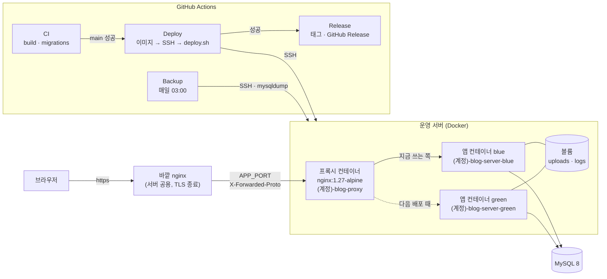
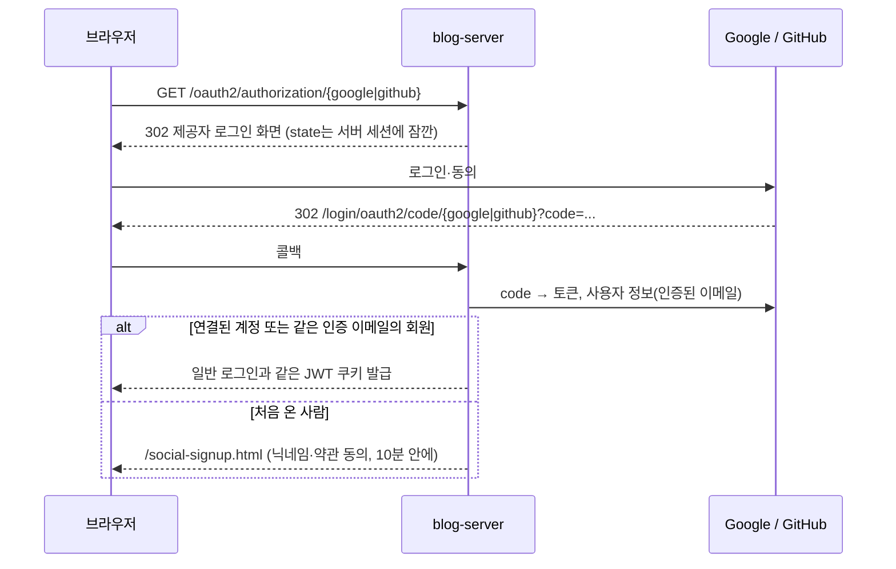
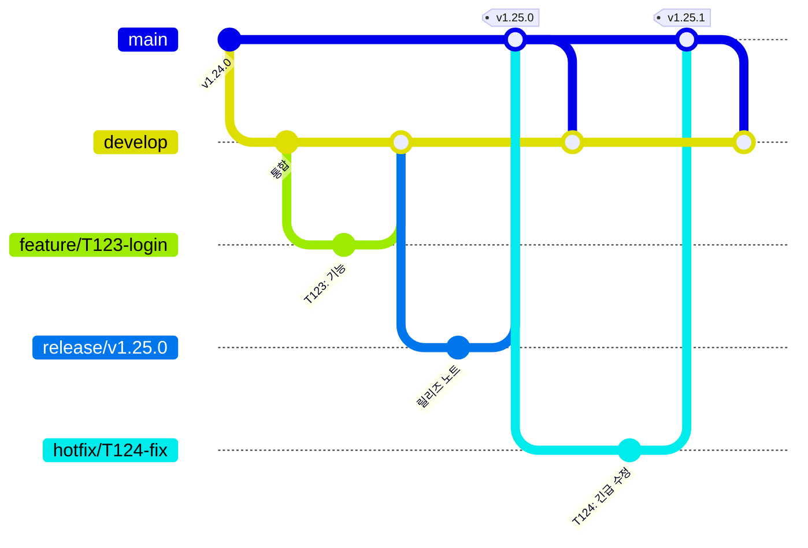

# blog-server

티스토리형 블로그 플랫폼(메인블로그)의 서버입니다. 누구나 블로그를 만들고, 여러 사람이 한 블로그에 함께 글을 쓰고, 다른 회원을 팔로우하거나 블로그를 구독할 수 있습니다. Spring Boot 애플리케이션 하나가 REST API와 정적 화면(HTML + JS)을 함께 내려주고, 모든 데이터는 MySQL 8 한 곳에 둡니다.

| | |
| --- | --- |
| 운영 사이트 | https://jj-blog.java21.net |
| GitHub Organization | [blogJJ](https://github.com/blogJJ) |
| 서버 (이 저장소) | [blogJJ/blog-server](https://github.com/blogJJ/blog-server) |
| 기획·설계 문서 | [blogJJ/blog-docs](https://github.com/blogJJ/blog-docs) — 요구사항분석서, [spec.md](https://github.com/blogJJ/blog-docs/blob/main/specs/001-main-blog/spec.md)(요구사항 ID), [research.md](https://github.com/blogJJ/blog-docs/blob/main/specs/001-main-blog/research.md)(결정 기록 D-번호), [data-model.md](https://github.com/blogJJ/blog-docs/blob/main/specs/001-main-blog/data-model.md), [tasks.md](https://github.com/blogJJ/blog-docs/blob/main/specs/001-main-blog/tasks.md)(작업 T-번호), ERD |
| 업데이트 기록 | 사이트의 [릴리즈 노트](https://jj-blog.java21.net/release-notes.html), 저장소 [Releases](https://github.com/blogJJ/blog-server/releases) |

조직 안의 두 저장소가 역할을 나눕니다. blog-docs는 "무엇을 왜 만드는가"(요구사항·정책·DB 설계)를, blog-server는 "어떻게 만들었는가"(코드·배포)를 담습니다. 작업은 blog-docs [tasks.md](https://github.com/blogJJ/blog-docs/blob/main/specs/001-main-blog/tasks.md)의 T-번호 단위로 하고, 커밋과 PR에 그 번호를 적어 두 저장소를 잇습니다.

## 목차

1. [주요 기능](#주요-기능)
2. [기술 스택](#기술-스택)
3. [아키텍처](#아키텍처)
4. [패키지 구조](#패키지-구조)
5. [개발환경](#개발환경)
6. [실행 환경 (local, prod)](#실행-환경-local-prod)
7. [파일 업로드](#파일-업로드)
8. [OAuth2 소셜 로그인](#oauth2-소셜-로그인)
9. [브랜치 전략 (Git Flow)](#브랜치-전략-git-flow)
10. [CI/CD 무중단 배포](#cicd-무중단-배포)
11. [운영 서버 배포](#운영-서버-배포)
12. [릴리즈 노트](#릴리즈-노트)
13. [자주 쓰는 명령](#자주-쓰는-명령)
14. [지킬 것](#지킬-것)

## 주요 기능

| 영역 | 기능 |
| --- | --- |
| 회원·인증 (`auth`) | 이메일 인증번호로 가입, 로그인·로그아웃, "로그인 유지"(14일) / 30분 무활동 시 로그아웃, 이메일 찾기·비밀번호 재설정, 내 정보·프로필 사진 수정, 회원 탈퇴 |
| 소셜 로그인 (`auth`) | 구글·깃허브 OAuth2 로그인과 가입, 내 정보에서 소셜 계정 연결·해제 |
| 보안 | JWT를 HttpOnly 쿠키로만 주고받음(Access 15분 + Refresh), 5번 실패 시 5분 잠금, 3번 실패부터 Cloudflare Turnstile 사람 확인, IP별 요청 제한(429), 개인정보 마스킹, 운영에서 https 강제 + HSTS |
| 블로그 (`blog`) | 블로그 만들기(공개 / 일부 공개 + 공유 링크 / 비공개), 참여 신청·승인, 매니저 지정, 멤버 경고·정지·내보내기, 블랙리스트와 해제 문의, 블로그장 위임, 블로그 폐쇄(예약 후 배치로 처리) |
| 꾸미기 | 블로그마다 이름·태그에 맞춘 픽셀 마스코트, 대표 이미지가 없을 때 보이는 움직이는 픽셀 대표 장면(장면·창밖 풍경·계절 장식 조합), AI가 그리는 대표 그림(선택), 밝은/어두운 모드 |
| 글·댓글 (`board`) | 마크다운 글쓰기(HTML은 jsoup으로 걸러냄), 카테고리, 태그, 이미지 올리기, 댓글, 좋아요, 조회수 |
| 파일 업로드 | 글 이미지·블로그 대표 이미지·프로필 사진. 형식 3중 검사, EXIF(GPS 등) 제거, 쓰임별 크기로 줄여 WebP로 저장 → [파일 업로드](#파일-업로드) |
| 메인 (`main`) | 메인 피드(최신·인기·팔로우·구독), 통합 검색(블로그·글 제목 FULLTEXT ngram, 태그, 닉네임), 최근 검색어, 공지사항, 릴리즈 노트 |
| 공유 미리보기 | 블로그·글 주소를 카카오톡·슬랙 등에 붙이면 제목·요약·그림이 담긴 Open Graph / 트위터 카드가 뜸(서버가 HTML에 og 태그를 넣음) |
| 소셜 (`social`) | 팔로우·팔로워, 블로그 구독, 회원 차단, 신고, 알림함(안 읽은 수, 종류별 끄기), 프로필 |
| 관리자 (`admin`) | 관리자 화면: 신고 처리, 회원·블로그·글·댓글 관리(숨김·삭제·복구), 경고·정지, 공지 작성, 통계, 관리자 활동 기록 |
| 배치 (`batch`) | 매일 04:00: 폐쇄 예정 블로그 처리와 3일·1일 전 알림, 기한 지난 위임 요청 만료, 보관 기간 지난 데이터 정리. ShedLock으로 한 서버에서만 실행 |
| 운영 | 매일 03:00 DB 백업(암호화해 Actions 아티팩트로 7일 보관), 요청 ID가 붙은 로그, `/actuator/health`, local 전용 Swagger |

## 기술 스택

| 구분 | 사용 기술 |
| --- | --- |
| 언어·런타임 | Java 21 (Eclipse Temurin) |
| 프레임워크 | Spring Boot 4.1.1 — Web MVC, Security, OAuth2 Client, Data JPA, Validation, Mail, Actuator |
| DB | MySQL 8 (로컬·테스트는 `mysql:8.4` 이미지), Flyway 마이그레이션, JPA `ddl-auto: validate` |
| 인증 | JJWT 0.13 (HttpOnly 쿠키), Spring Security OAuth2 Client (Google, GitHub), Cloudflare Turnstile |
| 글·이미지 | commonmark(+GFM 표·취소선), jsoup, metadata-extractor(EXIF), webp-imageio(libwebp), jsvg(SVG → PNG) |
| 기타 | ShedLock(배치 잠금), springdoc-openapi(Swagger), Anthropic Java SDK(마스코트·대표 그림, 선택) |
| 화면 | 정적 HTML + 바닐라 JS (`src/main/resources/static`) |
| 빌드·품질 | Gradle 9.8 (wrapper), Spotless + google-java-format |
| 테스트 | JUnit 5, Spring Boot Test, Testcontainers(MySQL) |
| 인프라 | Docker, nginx(블루그린 프록시), GitHub Actions(CI·배포·릴리즈·백업), Dependabot |

## 아키텍처



- 앱 컨테이너는 포트를 열지 않고 프록시와 같은 도커 네트워크에만 붙습니다. 바깥 nginx는 늘 같은 포트(`APP_PORT`)로 넘기고, 블루그린 전환은 프록시 컨테이너 설정만 바꿉니다.
- 화면은 정적 HTML이고 JS가 `/api/**`를 부릅니다. 블로그·글 주소(`/blog/{주소}`, `/blog/{주소}/posts/{번호}`)와 메인만 서버가 HTML에 공유 미리보기용 og 태그를 넣어 내려줍니다.

## 패키지 구조

기능(모듈)별로 패키지를 나누고, 모듈 안은 같은 네 층으로 나눕니다.

```text
src/main/java/com/blog/
├── auth/      회원·인증·소셜 로그인 (USR, SEC-01~05, 13)
├── blog/      블로그·멤버·참여·위임·폐쇄·블랙리스트·마스코트·대표 그림 (BLG)
├── board/     공통 게시판: 글, 댓글, 카테고리, 태그, 좋아요, 이미지 (BRD-01~07, 11)
├── main/      메인 피드, 통합 검색, 공지, 공유 미리보기, 릴리즈 노트 (BRD-08~10)
├── social/    팔로우, 구독, 알림, 차단, 신고, 프로필 (SOC)
├── admin/     메인 관리자 (ADM)
├── batch/     매일 04:00 배치 (DailyBatchJob, RetentionCleanup)
└── common/    보안 설정·JWT, 오류 응답, 로그, 메일, 마스킹, 파일 저장, 요청 제한
```

| 층 | 하는 일 |
| --- | --- |
| `domain/` | JPA 엔티티, 상태 값(enum) |
| `repository/` | Spring Data JPA 리포지토리, 조회 쿼리 |
| `service/` | 업무 규칙, 트랜잭션 |
| `api/` | REST 컨트롤러, 요청·응답 DTO, 화면 컨트롤러 |

`batch`는 작업 클래스 두 개만 있어 층을 나누지 않고, `common`은 `config`, `security`, `error`, `logging`, `storage` 같은 주제별 하위 패키지를 씁니다.

```text
src/main/resources/
├── application.yml          공통 설정(운영 기준 안전한 값). 값은 환경변수나 .env로 덮어씀
├── application-local.yml    개발자 컴퓨터용
├── application-prod.yml     운영 서버용
├── db/migration/            Flyway SQL (V1 테이블, V2 인덱스, V3 마스코트, V4 소셜 계정 …)
├── release-notes.json       사이트 릴리즈 노트와 GitHub Release의 원본
└── static/                  정적 HTML + JS 화면
```

그 밖의 폴더: `deploy/`(서버에서 실행하는 `deploy.sh`), `ops/backup/`(백업 스크립트와 [복구 절차](ops/backup/RESTORE.md)), `dummy/`(시험용 데이터 SQL), `docs/`([소셜 로그인 설정](docs/social-login.md)), `.github/`(워크플로, Dependabot, PR 템플릿).

## 개발환경

### 필요한 것

| 도구 | 버전 | 용도 |
| --- | --- | --- |
| JDK | 21 | 서버 실행·빌드 (Gradle toolchain이 21을 요구) |
| Docker Desktop | 최신 | 로컬 MySQL(`docker compose`), 테스트(Testcontainers가 MySQL을 띄움) |
| IntelliJ IDEA | 최신 (Community도 됨) | 개발 |

Gradle은 따로 설치하지 않아도 됩니다. 저장소의 `./gradlew`가 맞는 버전(9.8)을 받아 씁니다. Windows에서는 `./gradlew` 대신 `gradlew.bat`을 씁니다.

### 처음 실행하기

```bash
# 1. MySQL 띄우기 (처음 한 번은 이미지를 받느라 조금 걸림)
docker compose up -d

# 2. 비밀값 파일 만들기
cp .env.example .env
#    .env를 열어 JWT_SECRET(32바이트 이상, 예: openssl rand -base64 48)을 꼭 채운다. 비어 있으면 서버가 뜨지 않는다.
#    메일·Turnstile·소셜 로그인 키는 비워 둬도 local에서 뜬다(아래 표)

# 3. 서버 실행 (local 프로필)
./gradlew bootRun
```

- `docker-compose.yml`의 MySQL은 `blog` DB, 계정 `blog`/`blog`, 포트 3306, utf8mb4, Asia/Seoul, 통합 검색용 `ngram-token-size=2`로 뜹니다. `.env.example`의 DB 값이 이것과 맞춰져 있습니다.
- 서버를 처음 켜면 Flyway가 `db/migration`의 SQL을 차례로 실행해 테이블과 인덱스를 만듭니다. 다음부터는 새 파일만 실행합니다.
- 로그에 `Started BlogServerApplication`이 보이면 성공입니다. http://localhost:8080 에서 화면을, http://localhost:8080/swagger-ui.html 에서 API 문서를 봅니다.

local 프로필에서 키 없이도 되는 것:

| 기능 | local에서 키가 없을 때 |
| --- | --- |
| 메일(인증번호 등) | 보내지 않고 콘솔 로그에 찍음. 진짜로 보내려면 `MAIL_LOG_ONLY=false`와 `MAIL_USERNAME`·`MAIL_PASSWORD` |
| Turnstile | Cloudflare 공개 시험용 키(항상 통과). `.env`에 `TURNSTILE_SECRET_KEY=`처럼 빈 값을 두면 늘 실패하니 줄을 지우거나 주석으로 둠 |
| `HASH_SECRET` | 개발용 기본값 |
| 소셜 로그인 | 그 버튼이 숨음 |
| 마스코트·대표 그림(`ANTHROPIC_API_KEY`) | 태그 단어 사전으로 고르고, 대표 그림 대신 픽셀 장면 |

### 시험용 데이터

서버는 시험 데이터를 자동으로 넣지 않습니다. 필요할 때 직접 넣습니다(여러 번 넣어도 같은 행이 두 번 생기지 않음).

```bash
docker exec -i blog-mysql mysql -ublog -pblog blog < dummy/dummy_data.sql       # 회원 20명, 블로그 8개, 글·댓글·좋아요
docker exec -i blog-mysql mysql -ublog -pblog blog < dummy/dummy_data_bulk.sql  # 더 많은 회원·블로그·글
docker exec -i blog-mysql mysql -ublog -pblog blog < dummy/dummy_ops.sql        # 신고·참여 신청·제재 등 운영 데이터
```

시험 계정과 비밀번호는 `dummy/dummy_data.sql` 맨 위 주석에 있습니다(메인 관리자 계정 포함). 대량 파일은 `python3 dummy/make_bulk.py > dummy/dummy_data_bulk.sql`로 다시 만듭니다.

### IntelliJ 설정

- Gradle 프로젝트로 엽니다(File > Open > `build.gradle`). Project SDK와 Gradle JVM을 21로 맞춥니다.
- `BlogServerApplication`을 바로 실행할 때는 Run Configuration의 Active profiles에 `local`을 적습니다(`./gradlew bootRun`은 자동으로 local).
- 코드 모양은 google-java-format입니다. 플러그인 google-java-format을 설치해 켜 두면 편하고, 어떻든 커밋 전에 `./gradlew spotlessApply`를 돌립니다. `build`에서 `spotlessCheck`가 검사하므로 모양이 다르면 CI가 실패합니다.
- Database 창에서 `localhost:3306/blog`(blog/blog)에 붙이면 테이블과 시험 데이터를 바로 봅니다. DB 툴은 자동 커밋을 켜 두고 씁니다([Flyway 잠금](#운영-서버-배포) 참고).

### 테스트

```bash
./gradlew test     # 테스트만
./gradlew build    # 코드 모양 검사 + 컴파일 + 테스트 + jar
```

통합 테스트는 Testcontainers로 진짜 MySQL 8을 띄워 Flyway 마이그레이션과 엔티티 매핑까지 확인하므로 Docker가 켜져 있어야 합니다. 테스트 설정은 `src/test/resources/application-test.yml`입니다.

## 실행 환경 (local, prod)

| 프로필 | 언제 | 다른 점 |
| --- | --- | --- |
| local | 개발자 컴퓨터. `./gradlew bootRun`이 자동으로 고름 | Swagger 열림, 쿠키 Secure 꺼짐(http://localhost용), 메일은 콘솔에만, Turnstile 시험용 키, SQL 로그 |
| prod | 운영 서버. 이미지(`Dockerfile`)에 `SPRING_PROFILES_ACTIVE=prod` | 비밀값(`JWT_SECRET`, `HASH_SECRET`, `DB_PASSWORD`, `MAIL_PASSWORD`, `TURNSTILE_SECRET_KEY`)이 비었거나 예시 값이면 서버가 뜨지 않음, http → https로 돌려보냄 + HSTS, 절대 주소는 `SITE_URL`(기본 `https://jj-blog.java21.net`), 로그 파일 |
| (없음) | 프로필을 빠뜨렸을 때 | `application.yml`의 운영 기준 값: Swagger 닫힘, 쿠키 Secure |

| 주소 | 설명 |
| --- | --- |
| http://localhost:8080/swagger-ui.html | API 문서(Swagger). local에서만 열림 |
| http://localhost:8080/actuator/health | 서버 상태. `{"status":"UP"}`이면 정상(DB 연결 포함) |

로그는 모든 줄에 8자리 요청 ID가 붙고, 응답 헤더 `X-Request-Id`와 500 오류의 `errorId`가 같은 값입니다. local은 콘솔에만, 그 밖에는 `LOG_PATH`(기본 `./logs`)에 날짜별 파일로 남기고 30일 뒤 지웁니다.

## 파일 업로드

| 쓰임 | API | 줄이는 크기 |
| --- | --- | --- |
| 글 이미지 | `POST /api/images` (multipart `file`) → 받은 `url`을 본문에 넣음 | 가로 1600px |
| 블로그 대표 이미지 | `PUT /api/blogs/{blogId}/cover`, 지우기 `DELETE` | 가로 1600px |
| 프로필 사진 | `PUT /api/me/profile-image`, 지우기 `DELETE` | 긴 변 512px |

- **형식**: jpg·jpeg·png·gif·webp만 받습니다. 확장자, 브라우저가 보낸 MIME, 파일 앞부분(시그니처) 세 가지가 모두 같은 종류여야 합니다. SVG는 올릴 수 없습니다.
- **크기**: 장당 3MB, 한 요청 10MB(`spring.servlet.multipart`), 글 하나에 이미지 10장. 화소 수가 5천만을 넘는 그림은 풀기 전에 막습니다(압축 폭탄 방지). 글 이미지 올리기는 10분에 100장까지(요청 제한).
- **개인정보 제거**: EXIF·XMP·IPTC(JPEG), eXIf·tEXt 등(PNG), EXIF·XMP(WebP) 조각을 지워 촬영 위치(GPS)·기기 정보가 남지 않게 합니다. 휴대폰 사진의 회전 정보는 지우기 전에 그림을 돌려 반영합니다.
- **WebP 변환**: JPEG는 손실 WebP(품질 0.80), PNG는 무손실 WebP(사진 같은 PNG는 손실, 투명도 유지)로 다시 씁니다. 새 파일이 별로 작아지지 않으면 메타데이터만 지운 원본을 둡니다. GIF·WebP·움직이는 PNG는 움직임이 멈추지 않게 그대로 둡니다(메타데이터만 제거). WebP 인코더(libwebp, JNI)를 못 쓰는 환경이면 JPEG·PNG로 줄입니다. 동시에 그림을 푸는 요청은 2개까지만 받아 메모리를 지킵니다.
- **저장 위치**: 서버 디스크 `STORAGE_LOCAL_DIR`(기본 `./uploads`, 운영 컨테이너는 `/app/uploads` = 도커 볼륨 `<계정>-blog-uploads`라 재배포해도 남음). 파일 이름은 `UUID.확장자`이고, 원래 이름은 DB에만 둡니다. 이 형식이 아닌 이름은 열지 않아 `../` 같은 경로로 폴더 밖에 닿지 못합니다. 이중화 때 S3로 바꿀 수 있게 `FileStorage` 인터페이스 뒤에 둡니다.
- **보여 주기**: `GET /api/images/{저장 이름}`. 이름이 바뀌지 않으므로 `Cache-Control: public, max-age=31536000, immutable`(1년)로 내려줍니다. AI가 그린 SVG 대표 그림에는 `Content-Security-Policy: default-src 'none'; style-src 'unsafe-inline'; sandbox`를 붙여 주소를 바로 열어도 스크립트가 돌지 않게 합니다. 정적 그림 `/img/**`는 7일 캐시하고, HTML·JS·CSS는 배포 뒤 바로 바뀌어야 해서 캐시 기간을 따로 주지 않습니다.
- **정리**: 삭제한 지 30일 지난 글·사진과 폐쇄된 지 30일 지난 블로그의 사진은 04:00 배치가 파일까지 지웁니다.

## OAuth2 소셜 로그인

로그인·가입 화면의 "Google로 계속하기", "GitHub로 계속하기"는 Spring Security OAuth2 Client로 동작합니다. 키를 넣은 제공자만 버튼이 보이고, 키가 하나도 없어도 서버는 그대로 뜹니다. 자세한 설정 방법(구글 콘솔, 깃허브 OAuth App 만들기)은 [docs/social-login.md](docs/social-login.md)에 있습니다.



| 항목 | 값 |
| --- | --- |
| 운영 콜백 주소 | `https://jj-blog.java21.net/login/oauth2/code/google`, `https://jj-blog.java21.net/login/oauth2/code/github` |
| 로컬 콜백 주소 | `http://localhost:8080/login/oauth2/code/google`, `http://localhost:8080/login/oauth2/code/github` |
| 요청 범위 | 구글 `openid`, `email`, `profile` / 깃허브 `read:user`, `user:email` |
| 환경변수 (= Repository secret 이름) | `GOOGLE_CLIENT_ID`, `GOOGLE_CLIENT_SECRET`, `GH_CLIENT_ID`, `GH_CLIENT_SECRET` (깃허브는 secret 이름이 `GITHUB_`로 시작할 수 없어 `GH_`) |

- 처음 쓰는 소셜 계정은 제공자가 **인증한** 이메일과 같은 이메일의 회원이 있으면 그 계정에 연결합니다. 인증 안 된 이메일로는 연결하지 않습니다.
- 로그인 뒤에는 일반 로그인과 같은 JWT 쿠키를 쓰고, 로그인 잠금·계정 정지 규칙도 똑같이 적용됩니다. 비밀번호가 없는 회원은 마지막 소셜 연결을 끊을 수 없습니다.
- 운영은 바깥 nginx가 넘기는 `X-Forwarded-Proto: https`와 `SITE_URL`로 콜백 주소를 https로 만듭니다. 콘솔에는 위 https 주소를 글자 하나까지 같게 등록합니다.

## 브랜치 전략 (Git Flow)



| 브랜치 | 역할 | 어디서 만들고 어디로 합치나 | 실행되는 워크플로 |
| --- | --- | --- | --- |
| `main` | 운영. 여기 있는 코드가 https://jj-blog.java21.net 에 배포되어 있음 | release·hotfix PR로만 합침 | CI → **Deploy** → **Release** |
| `develop` | 다음 릴리즈를 모으는 통합 브랜치 | feature PR을 합침 | CI만 |
| `feature/*` | 기능 하나 (예: `feature/T123-image-upload`) | `develop`에서 만들고 → `develop`으로 PR | PR에서 CI(build, migrations) |
| `release/vX.Y.Z` | 릴리즈 준비 | `develop`에서 만들고 `release-notes.json` 맨 위에 새 버전 추가 → `main`으로 PR → 합친 뒤 `main`을 `develop`에 다시 합침 | PR에서 CI |
| `hotfix/*` | 운영 긴급 수정 | `main`에서 만들고 → `main`으로 PR(필요하면 PATCH 버전 추가) → 합친 뒤 `main`을 `develop`에 다시 합침 | PR에서 CI |

- `main`에 합쳐지는 순간 CI가 돌고, 통과하면 Deploy가 무중단으로 운영 서버에 올리고, 성공하면 Release가 `release-notes.json` 맨 위 버전으로 태그와 GitHub Release를 만듭니다. `develop`에 합치면 CI만 돌고 배포되지 않습니다.
- 버전은 `release-notes.json`이 정합니다. MAJOR는 아주 큰 업데이트, MINOR는 기능 추가, PATCH는 버그 수정·작은 변경입니다. 워크플로가 스스로 번호를 올리지 않습니다.
- 커밋 메시지와 PR 제목은 blog-docs [tasks.md](https://github.com/blogJJ/blog-docs/blob/main/specs/001-main-blog/tasks.md)의 T-번호로 시작합니다. 예: `T162: 올린 사진을 줄여 WebP로 저장`. 후속 수정은 `T162 후속: …`.
- PR 설명은 [PR 템플릿](.github/pull_request_template.md)(무엇을/왜, 관련 T-번호, 확인한 것)을 채웁니다. CI의 `build`와 `migrations`가 초록색이어야 합칩니다.
- 브랜치 보호(저장소 관리자): Settings > Branches에서 `main`과 `develop`에 "Require a pull request before merging"과 "Require status checks to pass"(build, migrations)를 켭니다.

## CI/CD 무중단 배포

`.github/workflows/`의 워크플로 네 개가 이어집니다.

| 워크플로 | 언제 | 하는 일 |
| --- | --- | --- |
| [ci.yml](.github/workflows/ci.yml) (CI) | 모든 PR, `main`·`develop` push | `build`: JDK 21 + Gradle 캐시로 `./gradlew build`(Spotless 검사, 컴파일, Testcontainers 통합 테스트). `migrations`(PR만): 이미 합쳐진 Flyway 파일을 고치지 않았는지, 파일 이름·번호가 맞는지 `.github/scripts/check-migrations.sh`로 검사 |
| [deploy.yml](.github/workflows/deploy.yml) (Deploy) | `main`의 CI가 성공하면(`workflow_run`), 또는 Actions 탭에서 직접 | CI가 통과한 바로 그 커밋으로 `bootJar` → 도커 이미지 → 서버에 SSH로 이미지·환경변수 파일·`deploy.sh` 업로드 → `deploy.sh` 실행(블루그린). 직접 실행 때 "더미 데이터 넣기"를 켜면 서버 안에서 더미 SQL을 넣음 |
| [release.yml](.github/workflows/release.yml) (Release) | Deploy가 성공하면 | `release-notes.json`의 `releases[0]` 버전으로 태그와 GitHub Release를 만듦. 본문은 파일의 바뀐 점 + 지난 태그 뒤 합쳐진 PR 목록. 그 버전 태그가 이미 있으면 건너뜀 |
| [backup.yml](.github/workflows/backup.yml) (Backup) | 매일 03:00(Asia/Seoul), 또는 직접 | 서버에서 DB 전체 백업 → 받아서 AES-256으로 암호화 → Actions 아티팩트로 7일 보관. 복구는 [ops/backup/RESTORE.md](ops/backup/RESTORE.md) |

Deploy와 Backup은 같은 `concurrency` 그룹이라 한 번에 하나씩만 돌고, 돌고 있는 배포를 끊지 않습니다.

### 무중단(블루그린) 순서 — `deploy/deploy.sh`

1. 받은 이미지를 불러오고, 지금 이미지는 `:previous` 태그로 남겨 둡니다(손으로 되돌릴 때).
2. 프록시 설정을 읽어 지금 응답 중인 쪽(blue/green)을 찾고, **반대쪽** 컨테이너를 새 이미지로 띄웁니다.
3. 새 컨테이너의 `/actuator/health`가 `UP`이 될 때까지 기다립니다. 한도는 `HEALTH_TIMEOUT`초(기본 240초 = 4분)이고, 20초마다 진행 상황을 찍어 SSH가 끊기지 않게 합니다.
4. `UP`이 되면 프록시 설정을 새 컨테이너로 바꾸고 `nginx -s reload`. 처리 중인 요청은 옛 컨테이너가 끝까지 보내고, 새 요청부터 새 컨테이너로 갑니다. 그 뒤 옛 컨테이너를 내립니다.
5. 한도 안에 `UP`이 안 되면 새 컨테이너의 마지막 로그를 보여 주고 지웁니다. 돌던 컨테이너가 그대로 응답하므로 사이트는 멈추지 않고, 워크플로는 실패로 끝납니다.

잠깐 두 버전이 같은 DB를 쓰므로 Flyway 마이그레이션은 옛 버전이 계속 돌 수 있게 만듭니다(칼럼·테이블 추가는 괜찮고, 지우거나 이름을 바꾸는 것은 다음 배포로 미룸).

### Repository secrets (이름만)

Settings > Secrets and variables > Actions의 Repository secrets에 넣습니다. 값은 저장소·이슈·PR 어디에도 적지 않습니다. 설명은 `deploy.yml`·`backup.yml` 맨 위 주석에 있습니다.

| 용도 | 이름 |
| --- | --- |
| 서버 접속 (Deploy, Backup) | `SSH_ADDRESS`, `SSH_PORT`, `SSH_ID`, `SSH_PASSWORD` |
| 바깥 nginx가 넘겨주는 포트 | `APP_PORT` |
| DB | `DB_ADDRESS`, `DB_PORT`, `DB_NAME`, `DB_USERNAME`, `DB_PASSWORD` |
| 서명·해시 키 | `JWT_SECRET`, `HASH_SECRET` |
| 메일(Gmail 앱 비밀번호) | `MAIL_USERNAME`, `MAIL_PASSWORD` |
| Cloudflare Turnstile | `TURNSTILE_SITE_KEY`, `TURNSTILE_SECRET_KEY` |
| 소셜 로그인 (선택) | `GOOGLE_CLIENT_ID`, `GOOGLE_CLIENT_SECRET`, `GH_CLIENT_ID`, `GH_CLIENT_SECRET` |
| 마스코트·대표 그림 (선택) | `ANTHROPIC_API_KEY` |
| 백업 암호 | `BACKUP_PASSPHRASE` |

## 운영 서버 배포

- 보통은 `main`에 합치면 자동으로 배포됩니다([CI/CD](#cicd-무중단-배포)). Actions 탭 > Deploy > Run workflow로 직접 돌릴 수도 있습니다.
- DB는 처음에 빈 DB면 됩니다. 서버가 처음 뜰 때 Flyway가 테이블을 만듭니다. `DB_ADDRESS`에는 **컨테이너 안에서 닿는 주소**를 넣습니다. 서버의 `/etc/hosts`가 바꿔 주는 이름은 도커 컨테이너 안에서는 적용되지 않아 다른 주소로 가서 `No route to host`가 날 수 있습니다.
- 더미 데이터: Run workflow에서 "더미 데이터 넣기"를 켜면 서버가 뜬 뒤 서버 안에서 mysql 클라이언트 컨테이너로 `dummy/dummy_data.sql`, `dummy/dummy_data_bulk.sql`, `dummy/dummy_ops.sql`을 넣습니다(회원 140명, 블로그 38개, 글 550개, 댓글 2,300개 등). 더미 계정은 비밀번호가 공개되어 있으니 실제로 쓰기 시작하면 관리자 계정 비밀번호부터 바꿉니다.
- 서버에서는 `~/blog-server/`에 파일이 있습니다. 공용 서버라 이름 앞에 접속 계정 이름을 붙입니다.

  | 이름 | 무엇 |
  | --- | --- |
  | `<계정>-blog-server-blue`, `<계정>-blog-server-green` | 번갈아 뜨는 앱 컨테이너 |
  | `<계정>-blog-proxy` | `APP_PORT`를 받는 nginx 프록시 컨테이너 |
  | `<계정>-blog-net` | 위 컨테이너들의 도커 네트워크 |
  | `<계정>-blog-uploads`, `<계정>-blog-logs` | 올린 파일·로그 볼륨 |

  로그는 `docker logs <계정>-blog-server-blue`(또는 `-green`)로 봅니다.
- **Flyway 잠금 문제**: DB 변경(Flyway)은 잠금을 30초까지만 기다립니다(`spring.flyway.init-sqls: SET SESSION lock_wait_timeout = 30`). 배포 로그에 `Lock wait timeout exceeded`가 보이면 누군가 트랜잭션을 열어 둔 것입니다. DB 툴에서 `SHOW FULL PROCESSLIST;`로 오래 `Sleep` 중인 외부 연결을 찾아 커밋하거나 `KILL`한 뒤 다시 배포합니다. 이때도 새 컨테이너만 실패하고 돌던 서버는 계속 응답합니다. DB 툴은 자동 커밋을 켜 두고 씁니다.
- **소셜 로그인**은 키를 secrets에 넣고 다시 배포해야 켜집니다([docs/social-login.md](docs/social-login.md)).
- **바깥 nginx**(서버 공용) 설정은 이 저장소 밖에서 합니다. `X-Forwarded-Proto`를 넘겨야 합니다(안 넘기면 앱이 https로 돌려보냅니다).
- **https 고정**: prod는 https 응답에 HSTS(`max-age=31536000`, 공용 학교 도메인이라 `includeSubDomains` 없음)를 붙이고, 공유 미리보기·소셜 로그인 콜백 같은 절대 주소를 `app.site-url`(기본 `https://jj-blog.java21.net`, `SITE_URL`로 바꿈, https가 아니면 서버가 뜨지 않음)로 만듭니다. 앱은 `X-Forwarded-Proto: http`로 온 요청을 https로 돌려보냅니다. 그런데 `http://jj-blog.java21.net`을 쳤는데도 http에 머무르면 바깥 nginx가 80번 요청을 `X-Forwarded-Proto: https`로 넘기고 있는 것이라 앱은 구분할 수 없습니다. 바깥 nginx의 80번 server 블록에 `return 301 https://$host$request_uri;`를 넣어 달라고 합니다. 한 번 https로 들어온 브라우저는 HSTS 덕분에 1년 동안 http를 쓰지 않습니다.

## 릴리즈 노트

- 사이트의 `/release-notes.html`(API `GET /api/release-notes`, `GET /api/release-notes/{버전}`)은 `src/main/resources/release-notes.json`을 보여 줍니다. 저장소가 비공개라 서버가 GitHub Releases를 읽지 못해서 파일로 둡니다.
- 사용자에게 보일 변경은 `release/vX.Y.Z`(또는 hotfix) 브랜치에서 파일 맨 위에 새 버전을 더합니다. 제목은 짧게, 바뀐 점은 사용자가 읽을 쉬운 말로 씁니다.
- 배포가 성공하면 `release.yml`이 맨 위 버전으로 태그와 GitHub Release를 만듭니다. 새 항목이 없으면(이미 태그가 있으면) 아무것도 하지 않고, 맨 위 버전이 마지막 태그보다 낮으면 실패합니다.

## 자주 쓰는 명령

| 명령 | 하는 일 |
| --- | --- |
| `./gradlew build` | 코드 모양 검사, 컴파일, 테스트, 실행 파일(`build/libs/blog-server.jar`) 만들기. 통합 테스트가 Docker로 MySQL을 띄우므로 Docker가 켜져 있어야 함 |
| `./gradlew spotlessApply` | 코드 모양을 google-java-format에 맞춰 자동으로 고침. 커밋 전에 한 번 |
| `./gradlew test` | 테스트만 |
| `./gradlew bootRun` | 서버 실행 (local 프로필) |
| `docker compose up -d` | 로컬 MySQL 켜기 |
| `docker compose down` | MySQL 끄기 (데이터는 남음) |
| `docker compose down -v` | MySQL 끄고 데이터까지 지우기 |

## 지킬 것

- 비밀값은 `.env`나 서버 환경변수(Repository secrets)에만 둡니다. `.env`는 `.gitignore`에 들어 있어 올라가지 않습니다.
- DB 구조는 Flyway SQL로만 바꿉니다. 테이블·컬럼을 바꾸려면 먼저 blog-docs의 [erd_tables.sql](https://github.com/blogJJ/blog-docs/blob/main/docs/02-database/schema/erd_tables.sql)을 고친 뒤, 이미 올라간 V 파일은 고치지 말고 다음 번호(`V5__설명.sql`)로 새 파일을 더합니다. 이미 실행된 파일을 고치면 Flyway가 체크섬이 다르다며 서버를 띄우지 않습니다(CI의 `migrations`가 PR에서 미리 막습니다).
- PR을 올리면 CI가 `./gradlew build`와 `migrations`를 돌립니다. 빨간 X가 뜨면 합치기 전에 고칩니다.
- Dependabot이 매주 월요일 Gradle 라이브러리와 GitHub Actions 업데이트 PR을 엽니다. CI가 통과하면 확인하고 합칩니다(자동 merge 없음).
- 시간대는 Asia/Seoul입니다. 서버 시작 때와 DB 연결, JSON에 모두 지정되어 있습니다.
- 원칙은 blog-docs의 [constitution.md](https://github.com/blogJJ/blog-docs/blob/main/.specify/memory/constitution.md)를 따릅니다(보안 먼저, 블로그별 역할은 요청마다 DB로 확인 등).
