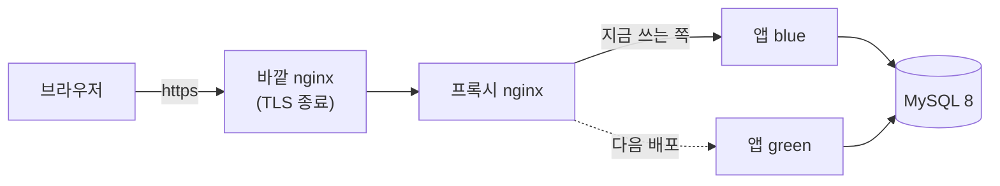

# blog-server

티스토리형 블로그 플랫폼(메인블로그)의 서버입니다. Spring Boot 애플리케이션 하나가 REST API(`/api/**`)와 정적 화면(HTML + 바닐라 JS)을 함께 내려주고, 데이터는 MySQL 8 한 곳에 둡니다. 요구사항·정책·DB 설계는 [blogJJ/blog-docs](https://github.com/blogJJ/blog-docs)에 있고, 이 저장소의 작업은 blog-docs [tasks.md](https://github.com/blogJJ/blog-docs/blob/main/specs/001-main-blog/tasks.md)의 T-번호로 연결됩니다.

| | |
| --- | --- |
| 운영 사이트 | https://jj-blog.java21.net |
| 기획·설계 | [spec.md](https://github.com/blogJJ/blog-docs/blob/main/specs/001-main-blog/spec.md)(요구사항 ID), [research.md](https://github.com/blogJJ/blog-docs/blob/main/specs/001-main-blog/research.md)(결정 D-번호), [data-model.md](https://github.com/blogJJ/blog-docs/blob/main/specs/001-main-blog/data-model.md), [tasks.md](https://github.com/blogJJ/blog-docs/blob/main/specs/001-main-blog/tasks.md)(작업 T-번호), [constitution.md](https://github.com/blogJJ/blog-docs/blob/main/.specify/memory/constitution.md)(원칙) |
| 업데이트 기록 | 사이트 [릴리즈 노트](https://jj-blog.java21.net/release-notes.html), 저장소 [Releases](https://github.com/blogJJ/blog-server/releases) |

## 핵심 개념

- **블로그별 역할은 요청마다 DB로 확인합니다.** 토큰에는 회원 번호만 있고, 블로그장·부블로그장 권한·멤버 정지·계정 정지는 `BlogAuthz`(`@PreAuthorize("@blogAuthz.isOwner(#blogId)")` 등)가 요청 때마다 DB에서 읽습니다. 메인 관리자(`ADMIN`)는 블로그 멤버가 아니지만 폐쇄되지 않은 모든 블로그의 관리 권한을 가집니다.
- **JWT + 로그인 번호.** Access Token(기본 15분)과 Refresh Token을 HttpOnly 쿠키로만 주고받습니다. Access Token에는 회원 번호(`sub`)와 로그인 번호(`sid` = `refresh_tokens.id`)만 담고, 필터가 그 로그인 행을 DB에서 다시 읽어 로그아웃·비밀번호 변경·30분 무활동·탈퇴를 바로 반영합니다. "로그인 유지"는 14일입니다.
- **스키마는 Flyway만 바꿉니다.** `ddl-auto: validate`라 엔티티와 테이블이 다르면 서버가 뜨지 않습니다. 기준은 blog-docs [erd_tables.sql](https://github.com/blogJJ/blog-docs/blob/main/docs/02-database/schema/erd_tables.sql)이고, 이미 합쳐진 V 파일은 고치지 않고 다음 번호를 더합니다(현재 V1~V5).
- **AI는 없어도 동작합니다.** `ANTHROPIC_API_KEY`가 없거나 호출이 실패하면 Claude를 부르지 않고 대체 동작으로 갑니다.

  | 기능 | 키가 없거나 실패하면 |
  | --- | --- |
  | 마스코트·대표 픽셀 장면 고르기 | 태그 단어 사전으로 고름 |
  | 대표 그림(SVG) | 그리지 않고 픽셀 장면을 보여 줌 |
  | 글쓰기 도우미 | 태그 추천은 단어 세기로, 맞춤법 버튼은 숨김 |
  | 새 댓글 자동 검사 | 검사하지 않고 댓글을 그대로 둠(fail-open) |

- **배포 중에는 옛·새 버전이 같은 DB를 씁니다.** 블루그린 전환 동안 두 버전이 함께 돌므로 마이그레이션은 추가만 합니다. 칼럼·테이블 추가는 괜찮고, 지우거나 이름을 바꾸는 것은 다음 배포로 미룹니다.

## 기술 스택

Java 21 · Spring Boot 4.1.1(Web MVC, Security, OAuth2 Client, Data JPA, Validation, Mail, Actuator, Flyway) · JJWT 0.13.0 · commonmark 0.30.0(+GFM 표·취소선) · jsoup 1.23.2 · metadata-extractor 2.21.0 · webp-imageio 0.11.0 · jsvg 2.2.0 · ShedLock 7.10.1 · springdoc-openapi 3.1.1 · Anthropic Java SDK 2.34.0 · Gradle 9.8.1(wrapper) · Spotless 8.10.4(google-java-format) · JUnit 5 + Testcontainers

그 외: MySQL 8(로컬·테스트는 `mysql:8.4`), Docker(`eclipse-temurin:21-jre` 이미지), nginx(`nginx:1.27-alpine`, 블루그린 프록시), GitHub Actions, Dependabot, Cloudflare Turnstile.

## 주요 API / 화면

| 패키지 | 기본 경로 | 내용 |
| --- | --- | --- |
| `auth` | `/api/auth/**`, `/api/me/**` | 이메일 인증 가입, 로그인·로그아웃·재발급·연장, 이메일 찾기, 비밀번호 재설정, 내 정보·프로필 사진, 탈퇴, 소셜 계정 연결·해제 |
| `auth` | `/oauth2/authorization/{google\|github}` | 구글·깃허브 OAuth2 로그인([docs/social-login.md](docs/social-login.md)) |
| `blog` | `/api/blogs/**`, `/api/transfers/**` | 블로그 만들기·수정·대표 이미지·공유 링크, 참여 신청·승인, 멤버 경고·정지·내보내기, 매니저 권한, 블랙리스트·해제 문의, 블로그 신고 처리, 블로그장 위임, 폐쇄 예약·취소 |
| `board` | `/api/blogs/{blogId}/posts`, `/api/posts/**`, `/api/comments/**`, `/api/images/**` | 마크다운 글, 카테고리, 태그, 댓글, 댓글 확인(자동 검사로 숨긴 댓글), 좋아요, 이미지 올리기·보기, 글쓰기 도우미(`/api/posts/assist/**`) |
| `main` | `/api/feed`, `/api/search`, `/api/notices`, `/api/release-notes`, `/api/og/covers/**` | 메인 피드, 통합 검색(FULLTEXT ngram)·최근 검색어, 공지, 릴리즈 노트, 비슷한 글, 공유 미리보기 그림 |
| `main` | `/`, `/blog/{주소}`, `/blog/{주소}/posts/{번호}` | 화면 HTML에 Open Graph·트위터 카드 og 태그를 넣어 내려줌 |
| `social` | `/api/users/**`, `/api/notifications/**`, `/api/reports` | 팔로우·팔로워, 블로그 구독, 차단, 신고, 알림함·알림 설정, 프로필 |
| `admin` | `/api/admin/**`, `/admin` | 신고 처리, 회원·블로그·글·댓글 관리(숨김·삭제·복구), 경고·정지, 공지 작성, 통계, 관리자 활동 기록 |

그 밖의 화면은 `src/main/resources/static`의 정적 HTML이고 JS가 `/api/**`를 부릅니다. 전체 API는 local 프로필의 http://localhost:8080/swagger-ui.html 에서 봅니다.

## 동작 흐름

```text
요청 → RequestIdFilter(요청 ID) → RateLimitFilter(IP별 /api 제한)
     → Spring Security(https 강제·CSRF·URL 규칙) → JwtCookieAuthFilter(쿠키 JWT + 로그인 행 DB 확인)
     → Controller(@PreAuthorize @blogAuthz…) → Service(업무 규칙·트랜잭션 5초) → Repository(JPA) → MySQL
```

`com.blog.{auth,blog,board,main,social,admin,batch,common}`: `auth` 회원·인증·소셜 로그인, `blog` 블로그·멤버·위임·폐쇄·마스코트·대표 그림, `board` 글·댓글·이미지, `main` 피드·검색·공지·공유 미리보기·릴리즈 노트, `social` 팔로우·구독·알림·차단·신고, `admin` 메인 관리자, `batch` 매일 04:00 배치, `common` 보안·JWT·오류·로그·메일·파일 저장·요청 제한. 모듈 안은 `domain/`(엔티티), `repository/`, `service/`, `api/`(컨트롤러·DTO)로 나눕니다.



## 인증 / 오류

- **인증**: HttpOnly 쿠키의 Access Token 서명·만료, 그 로그인(`sid`) 행이 살아 있는지, 회원 상태를 확인합니다. 역할은 DB 값을 씁니다. Authorization 헤더나 localStorage는 쓰지 않습니다.
- **URL 규칙**: `/api/auth/**`와 `GET /api/**`는 비회원도, `/api/me/**`·`/api/notifications/**`와 그 밖의 쓰기 API는 로그인, `/api/admin/**`·`/admin`은 `ADMIN`. 정하지 않은 요청은 막습니다.
- **그 밖의 검사**: CSRF(SPA 방식 쿠키·헤더), 5번 실패 시 5분 잠금, 3번 실패부터 Turnstile, IP별 API 요청 제한(기본 분당 600, 넘으면 429 + `Retry-After`), 요청 처리 5초 제한, prod는 https 강제 + HSTS.

API 오류는 모두 `GlobalExceptionHandler`(보안 필터 단계는 `JsonSecurityErrorHandler`)가 같은 모양으로 답합니다. `code`는 `ErrorCode` 이름이고, `errorId`는 500일 때만 붙으며 로그의 요청 ID(`X-Request-Id`)와 같습니다. 화면 주소의 403·404·500은 `static/error`의 안내 화면을 보여 줍니다.

```json
{ "code": "INTERNAL_ERROR", "message": "일시적인 오류가 생겼어요. 잠시 뒤 다시 시도해 주세요.", "errorId": "a1b2c3d4" }
```

| 상태 | 대표 code |
| --- | --- |
| 400 | `INVALID_INPUT`, `CAPTCHA_REQUIRED`, `CODE_INVALID`, `CODE_EXPIRED` |
| 401 | `UNAUTHORIZED`, `LOGIN_FAILED` |
| 403 | `FORBIDDEN`, `ACCOUNT_SUSPENDED`, `BLACKLISTED` |
| 404 | `NOT_FOUND` |
| 409 | `CONFLICT`, `DUPLICATE_EMAIL`, `DUPLICATE_NICKNAME`, `WITHDRAW_BLOCKED` |
| 413 / 423 / 429 | `PAYLOAD_TOO_LARGE` / `ACCOUNT_LOCKED` / `TOO_MANY_REQUESTS` |
| 503 | `REQUEST_TIMEOUT`, `MAIL_SEND_FAILED`, `ASSIST_UNAVAILABLE` |
| 500 | `INTERNAL_ERROR` (+ `errorId`) |

## 설정 / 프로파일

| 프로필 | 포트 | 로그 | 용도 |
| --- | --- | --- | --- |
| `local` | 8080 | 콘솔, SQL 로그 | 개발자 컴퓨터. `./gradlew bootRun`이 자동 선택. Swagger 열림, 쿠키 Secure 꺼짐, 메일은 콘솔에만, Turnstile 시험용 키, `HASH_SECRET` 개발용 기본값 |
| `prod` | 8080 | `LOG_PATH`(이미지 `/app/logs`)에 날짜별 파일, 30일 보관 | 운영. 이미지에 `SPRING_PROFILES_ACTIVE=prod`. 비밀값이 비었거나 예시 값이면 뜨지 않음(`ProdSecretsCheck`), https 강제 + HSTS, 절대 주소는 `SITE_URL` |
| `test` | - | 콘솔 | 테스트(`src/test/resources/application-test.yml`). 외부 AI 호출 없음 |
| (없음) | 8080 | 파일 | `application.yml`의 운영 기준 안전한 값: Swagger 닫힘, 쿠키 Secure |

공통: `/actuator/health`만 열려 있고(`UP`/`DOWN`만), 모든 로그 줄에 8자리 요청 ID가 붙습니다.

환경변수(값은 `.env` 또는 서버 환경변수, [.env.example](.env.example) 참고):

| 구분 | 이름 |
| --- | --- |
| 필수 | `DB_URL`, `DB_USERNAME`, `DB_PASSWORD`, `JWT_SECRET`(32바이트 이상) |
| prod에서 비면 안 뜸 | `JWT_SECRET`, `HASH_SECRET`, `DB_PASSWORD`, `MAIL_PASSWORD`, `TURNSTILE_SECRET_KEY` (함께 `MAIL_USERNAME`, `TURNSTILE_SITE_KEY`) |
| 선택 | `ANTHROPIC_API_KEY`, `GOOGLE_CLIENT_ID`, `GOOGLE_CLIENT_SECRET`, `GH_CLIENT_ID`, `GH_CLIENT_SECRET`, `SITE_URL`, `STORAGE_LOCAL_DIR`, `LOG_PATH`, `BLOG_LIMIT_PUBLIC`, `RATE_LIMIT_API_PER_MINUTE`, `JWT_ACCESS_TOKEN_TTL`, `MAIL_LOG_ONLY`(local), `FORWARD_HEADERS_STRATEGY` |

## 로컬 실행

```bash
docker compose up -d          # MySQL 8.4: blog DB, utf8mb4, Asia/Seoul, ngram-token-size=2
cp .env.example .env          # JWT_SECRET을 채운다 (예: openssl rand -base64 48). 비어 있으면 뜨지 않음
./gradlew bootRun             # local 프로필, http://localhost:8080
```

- 처음 뜰 때 Flyway가 테이블을 만듭니다. 시험 데이터는 자동으로 넣지 않으므로 필요하면 `docker exec -i blog-mysql mysql -ublog -pblog blog < dummy/dummy_data.sql`(그 밖에 `dummy_data_bulk.sql`, `dummy_ops.sql`)로 넣습니다. 시험 계정은 `dummy/dummy_data.sql` 맨 위 주석에 있습니다.
- IntelliJ: `build.gradle`로 열고 SDK·Gradle JVM을 21로, `BlogServerApplication`을 직접 실행할 때는 Active profiles에 `local`.

## 테스트

```bash
./gradlew test     # 테스트만 + 커버리지 보고서
./gradlew build    # spotlessCheck + 컴파일 + 테스트 + build/libs/blog-server.jar
```

JUnit 5 테스트 메서드 약 570개(`@Test`·`@ParameterizedTest`)입니다. 테스트가 끝나면 JaCoCo가 커버리지 보고서를 `build/reports/jacoco/test/html/index.html`(SonarQube·SonarLint용 XML은 `jacocoTestReport.xml`)에 만듭니다. 2026-10-13 기준 줄 95.7%, 분기 84.8%(소나 방식 합산 92.8%)입니다. main·develop에 푸시되면 CI가 분석 결과를 SonarQube 프로젝트 `jj-blog`로 보냅니다(저장소 시크릿 `SONAR_HOST_URL`·`SONAR_TOKEN` 필요). 통합 테스트는 Testcontainers로 진짜 MySQL 8을 띄워 Flyway 마이그레이션과 엔티티 매핑까지 확인하므로 dockerd(Docker Desktop)가 켜져 있어야 합니다. AI 호출은 가짜 클라이언트·가짜 서버로 대신합니다.

## 브랜치 / 배포

Git Flow입니다. `feature/*`는 `develop`에서 만들어 `develop`으로, `release/vX.Y.Z`는 `develop`에서 만들어 `main`으로, `hotfix/*`는 `main`에서 만들어 `main`으로 PR합니다. `main`에 합친 뒤에는 `main`을 `develop`에 다시 합칩니다. 커밋·PR 제목은 T-번호로 시작합니다(예: `T162: 올린 사진을 줄여 WebP로 저장`, 후속은 `T162 후속: …`). PR은 [템플릿](.github/pull_request_template.md)을 채우고 CI의 `build`·`migrations`가 통과해야 합칩니다.

| 워크플로 | 언제 | 하는 일 |
| --- | --- | --- |
| [CI](.github/workflows/ci.yml) | 모든 PR, `main`·`develop` push | `build`: `./gradlew build`. `migrations`(PR만): 합쳐진 Flyway 파일을 고치지 않았는지, 이름·번호가 맞는지 |
| [Deploy](.github/workflows/deploy.yml) | `main`의 CI 성공 뒤(또는 직접 실행) | 그 커밋으로 jar·도커 이미지 → SSH로 서버에 올림 → `deploy/deploy.sh`(블루그린). 직접 실행 때 "더미 데이터 넣기" 선택 가능 |
| [Release](.github/workflows/release.yml) | Deploy 성공 뒤 | `release-notes.json` 맨 위(`releases[0]`) 버전으로 태그와 GitHub Release. 이미 있는 태그면 건너뜀 |
| [Backup](.github/workflows/backup.yml) | 매일 03:00(Asia/Seoul), 또는 직접 | 서버 DB 전체 백업 → AES-256 암호화 → Actions 아티팩트 7일 보관. 복구는 [RESTORE.md](ops/backup/RESTORE.md) |

블루그린 순서(`deploy/deploy.sh`):

1. 지금 이미지를 `:previous`로 남기고, 지금 응답 중인 쪽의 **반대쪽**(blue/green) 컨테이너를 새 이미지로 띄웁니다.
2. 새 컨테이너의 `/actuator/health`가 `HEALTH_TIMEOUT`(기본 240초) 안에 `UP`이 되면 프록시 설정을 바꾸고 `nginx -s reload`, 옛 컨테이너를 내립니다.
3. 시간 안에 `UP`이 안 되면 새 컨테이너만 지우고 실패로 끝납니다. 돌던 컨테이너가 계속 응답합니다.

Deploy와 Backup은 같은 `concurrency` 그룹이라 하나씩만 돕니다. Repository secrets(이름만): `SSH_ADDRESS`, `SSH_PORT`, `SSH_ID`, `SSH_PASSWORD`, `APP_PORT`, `DB_ADDRESS`, `DB_PORT`, `DB_NAME`, `DB_USERNAME`, `DB_PASSWORD`, `JWT_SECRET`, `HASH_SECRET`, `MAIL_USERNAME`, `MAIL_PASSWORD`, `TURNSTILE_SITE_KEY`, `TURNSTILE_SECRET_KEY`, `GOOGLE_CLIENT_ID`, `GOOGLE_CLIENT_SECRET`, `GH_CLIENT_ID`, `GH_CLIENT_SECRET`, `ANTHROPIC_API_KEY`, `BACKUP_PASSPHRASE`. 깃허브 키는 secret 이름이 `GITHUB_`로 시작할 수 없어 `GH_`를 씁니다.

운영 메모:

- Flyway는 잠금을 30초까지만 기다립니다(`lock_wait_timeout = 30`). 배포 로그에 `Lock wait timeout exceeded`가 보이면 DB 툴에서 `SHOW FULL PROCESSLIST;`로 오래 열린 트랜잭션을 찾아 커밋하거나 `KILL`한 뒤 다시 배포합니다. DB 툴은 자동 커밋을 켜 두고 씁니다.
- 바깥 nginx는 `X-Forwarded-Proto`를 넘겨야 합니다. http로 머무르면 바깥 nginx의 80번 server 블록에 `return 301 https://$host$request_uri;`가 필요합니다.
- 소셜 로그인 키는 secrets에 넣고 다시 배포해야 켜집니다.

## 기타

**릴리즈 노트**: 사이트 `/release-notes.html`(`GET /api/release-notes`)은 `src/main/resources/release-notes.json`을 보여 줍니다. 사용자에게 보일 변경은 release(또는 hotfix) 브랜치에서 파일 맨 위에 새 버전을 더합니다. 버전은 파일이 정하고(MAJOR 큰 업데이트, MINOR 기능 추가, PATCH 버그 수정), 워크플로가 번호를 올리지 않습니다. 맨 위 버전이 마지막 태그보다 낮으면 Release가 실패합니다.

**파일 업로드**: jpg·jpeg·png·gif·webp만(확장자·MIME·시그니처 3중 검사, SVG 불가), 장당 3MB·요청 10MB, EXIF 등 메타데이터 제거 후 쓰임별 크기(글·대표 이미지 가로 1600px, 프로필 긴 변 512px)로 줄여 WebP로 저장합니다. 저장 위치는 `STORAGE_LOCAL_DIR`(운영은 도커 볼륨), `FileStorage` 인터페이스 뒤에 둡니다.

**지킬 것**

- 비밀값은 `.env`나 서버 환경변수(Repository secrets)에만 둡니다. `.env`는 올라가지 않습니다.
- DB 구조는 Flyway SQL로만, blog-docs `erd_tables.sql`을 먼저 고친 뒤 새 V 파일로 바꿉니다. 실행된 파일을 고치면 체크섬이 달라 서버가 뜨지 않습니다.
- 커밋 전에 `./gradlew spotlessApply build`. 모양이 다르면 CI가 실패합니다.
- Dependabot이 매주 월요일 Gradle·Actions 업데이트 PR을 엽니다. 자동 merge는 없습니다.
- 시간대는 Asia/Seoul입니다(JVM, DB 연결, JSON).
